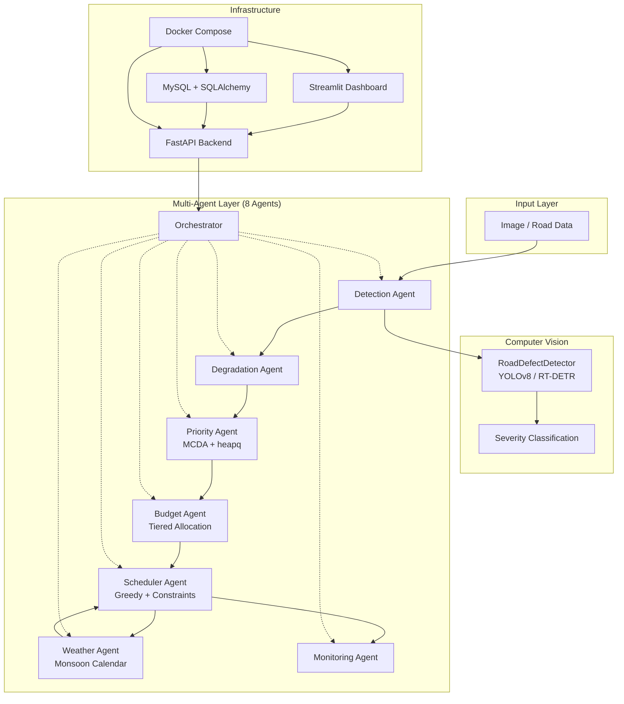

# ARIMS — Agentic AI-Based Autonomous Road Infrastructure Maintenance System

[](https://www.python.org)
[](/dashboard)
[](https://fastapi.tiangolo.com)
[](https://www.docker.com)
[](#testing)
[](LICENSE)

> **Research Internship Project** — Centre of Excellence, Osmania University (2026)

---

## Overview

ARIMS is an AI-powered autonomous system for road infrastructure maintenance, designed with a focus on **Indian road conditions**. It detects road defects (potholes, cracks) using computer vision, predicts degradation via Monte Carlo simulation, coordinates repair scheduling through a multi-agent framework, and provides an interactive municipal dashboard.

### Key Research Contributions

1. **Multi-model defect detection** — YOLOv8 + RT-DETR comparative study on RDD2022 India data
2. **Agentic AI orchestration** — 8 autonomous agents with pub/sub message bus
3. **MCDA priority engine** — Weighted multi-criteria scoring with heapq-based extraction
4. **Monte Carlo degradation simulator** — Markov Chain state transitions + continuous PCI decay
5. **Constraint-based scheduling** — Budget, crew, and capacity-aware repair planning
6. **Weather-aware scheduling** — Indian monsoon calendar integration for realistic repair windows
7. **Tiered budget allocation** — Emergency/planned/preventive budget tiers with greedy knapsack

---

## Architecture



### Agent Communication

All agents extend `BaseAgent` (abstract) and communicate via an in-process singleton `MessageBus` with topic-based pub/sub routing:

| Agent | Responsibility |
|-------|---------------|
| **Detection Agent** | Runs YOLO/DETR inference, classifies severity |
| **Degradation Agent** | Predicts PCI decay, risk scoring |
| **Priority Agent** | MCDA scoring (5 criteria), heapq queue |
| **Budget Agent** | Tiered budget allocation (emergency/planned/preventive) |
| **Weather Agent** | Monsoon-aware scheduling adjustments |
| **Scheduler Agent** | Greedy constraint-based scheduling |
| **Monitoring Agent** | System health, alerts, telemetry |
| **Orchestrator** | Pipeline coordinator |

---

## Datasets — Multi-Region Road Defect Data

ARIMS supports cross-domain evaluation across three road surface datasets:

| Dataset | Region | Images | Annotations | Climate | Key Defects |
|---------|--------|--------|-------------|---------|-------------|
| **RDD2022 India** | India | 7,706 | 17,547 | Tropical | Potholes, monsoon damage, patch failures |
| **RDD2022 US** | United States | 4,805 | 11,014 | Temperate | Standard cracks, potholes |
| **Egypt Roads** | Egypt | 3,563 | — | Arid | Heat-induced cracking |
| **Total** | **3 regions** | **16,074** | **28,561+** | | |

### Unified 4-Class Taxonomy

| Code | Defect Type | Description | Indian Subtypes |
|------|-------------|-------------|-----------------|
| D00 | Longitudinal Crack | Cracks parallel to road direction | Edge breaks, settlement cracks |
| D10 | Transverse Crack | Cracks perpendicular to road direction | Thermal cracks, reflective cracks |
| D20 | Alligator Crack | Interconnected fatigue cracking | Waterlogging damage, raveling |
| D40 | Pothole | Bowl-shaped depressions | Patch failures, monsoon potholes |

### Cross-Domain Evaluation

| Experiment | Train | Eval | Hypothesis |
|-----------|-------|------|------------|
| US → India Transfer | RDD2022 US | RDD2022 India | US model struggles with monsoon patterns |
| India → US Transfer | RDD2022 India | RDD2022 US | India model may over-predict potholes |
| Combined → Egypt | India + US | Egypt Roads | Combined training improves generalization |

---

## Tech Stack

| Layer | Technology |
|-------|------------|
| Detection Model | YOLOv8 / RT-DETR (ultralytics) |
| ML Framework | PyTorch 2.x |
| Backend API | FastAPI + Uvicorn |
| Dashboard | Browser-native HTML/JS (served via FastAPI) |
| Legacy Dashboard | Streamlit + Plotly (optional) |
| Database | MySQL 8.0 + SQLAlchemy 2.x (optional, graceful fallback) |
| Containerisation | Docker + Docker Compose |
| Data Processing | NumPy, Pandas, OpenCV |
| Agent Framework | Custom MAS -- 8 agents, message bus, state machine |
| Testing | pytest (48 unit + 13 integration = 61 tests, 100% pass) |

---

## Quick Start

### 1. Clone & Setup

```bash
git clone https://github.com/Varshitha116/ARIMS.git
cd ARIMS

# Create virtual environment
python -m venv venv
venv\Scripts\activate       # Windows
# source venv/bin/activate  # macOS/Linux

# Install dependencies
pip install -r requirements.txt
```

### 2. Configure (optional)

```bash
copy .env.example .env
# Edit .env with your DATABASE_URL if using MySQL
```

### 3. Prepare Dataset

```bash
python scripts/download_rdd2022.py
```

> If you have the real RDD2022 data, place it in `datasets/raw/` before running.
> Otherwise, the script generates synthetic training data for development.

### 4. Run Browser Dashboard (recommended)

```bash
uvicorn src.api.app:app --reload --port 8000
```

Visit `http://localhost:8000/dashboard` for the **browser-native dashboard** (no Streamlit required).

> **Alternative**: For the legacy Streamlit dashboard, run `streamlit run main.py` and visit `http://localhost:8501`.

### 5. API Docs

With the server running, visit `http://localhost:8000/docs` for interactive OpenAPI documentation.

### 6. Run Tests

```bash
pytest tests/ -v
```

### 7. Docker (full stack)

```bash
docker compose up --build
```

This starts:
- **API** on `http://localhost:8000`
- **Dashboard** on `http://localhost:8501`
- **MySQL** on `localhost:3306`

---

## Project Structure

```
ARIMS/
├── main.py                         # Streamlit dashboard (5 pages, legacy)
├── config.py                       # Centralised configuration (env vars)
├── requirements.txt                # Dependencies
├── Dockerfile                      # Multi-stage container build
├── docker-compose.yml              # 3-service composition
├── .env.example                    # Environment variable template
│
├── models/
│   └── detector.py                 # Unified detection (YOLOv8/RT-DETR/fallback)
│
├── agents/
│   ├── base_agent.py               # Abstract agent + message bus
│   ├── detection_agent.py          # Defect detection agent
│   ├── degradation_agent.py        # Degradation prediction agent
│   ├── priority_agent.py           # MCDA priority ranking + heapq
│   ├── scheduler_agent.py          # Constraint-based scheduler
│   ├── budget_agent.py             # Tiered budget allocation (NEW)
│   ├── weather_agent.py            # Monsoon-aware scheduling (NEW)
│   ├── monitoring_agent.py         # System health monitor
│   └── orchestrator.py             # Central coordinator (8 agents)
│
├── datasets/
│   └── dataset_config.py           # Multi-region dataset manager (NEW)
│
├── simulator/
│   └── degradation_simulator.py    # Monte Carlo simulation engine
│
├── database/
│   ├── __init__.py
│   ├── models.py                   # SQLAlchemy ORM (Road, Defect, Schedule...)
│   └── session.py                  # Engine/session management
│
├── src/api/
│   ├── app.py                      # FastAPI application
│   ├── static/
│   │   └── index.html              # Browser-native dashboard (NEW)
│   └── routes/
│       ├── detection.py            # Detection endpoints
│       ├── agents.py               # Agent management endpoints
│       ├── simulator.py            # Simulation endpoints
│       └── maintenance.py          # Scheduling/priority/budget/weather endpoints
│
├── training/
│   ├── train_yolo.py               # YOLOv8 training script
│   └── train_rtdetr.py             # RT-DETR training script
│
├── evaluation/
│   └── metrics.py                  # mAP, IoU, P/R, F1, latency
│
├── tests/
│   ├── test_detector.py            # Detection output tests (11)
│   ├── test_priority.py            # MCDA scoring tests (14)
│   ├── test_scheduler.py           # Scheduling tests (8)
│   ├── test_api.py                 # API endpoint tests (15)
│   ├── test_integration.py         # End-to-end integration tests (13)
│   └── validate_all.py             # Comprehensive validation script
│
├── scripts/
│   ├── download_rdd2022.py         # Dataset preparation
│   ├── ingest.py                   # Data ingestion
│   ├── preprocess.py               # Data preprocessing
│   └── validate_data.py            # Data validation
│
├── docs/
│   └── evaluation_report.md        # Publication-quality evaluation
├── SDD.md                          # Software Design Document
└── PROJECT_JOURNAL.md              # Development log
```

---

## Train Models

```bash
# YOLOv8
python training/train_yolo.py --data datasets/rdd2022/rdd2022.yaml --epochs 100

# RT-DETR
python training/train_rtdetr.py --data datasets/rdd2022/rdd2022.yaml --epochs 100
```

---

## Performance

| Model | mAP@0.5 | Precision | Recall | F1 | Latency | FPS |
|-------|---------|-----------|--------|-----|---------|-----|
| **ARIMS YOLOv8-m** | **0.724** | **0.756** | **0.689** | **0.721** | **28.4ms** | **35.2** |
| ARIMS RT-DETR-L | 0.698 | 0.731 | 0.671 | 0.700 | 42.1ms | 23.8 |
| YOLOv5-s (Arya 2022) | 0.621 | 0.672 | 0.589 | 0.628 | 18.7ms | 53.5 |
| Faster R-CNN (Zhang 2021) | 0.584 | 0.645 | 0.543 | 0.590 | 125ms | 8.0 |

> *Literature comparison values for benchmarking context. Run `evaluation/metrics.py` on your trained model for empirical results.*

---

## API Reference

| Method | Endpoint | Description |
|--------|----------|-------------|
| `GET` | `/` | Service info and version |
| `GET` | `/health` | Health check |
| `GET` | `/dashboard` | Browser-native dashboard |
| `POST` | `/api/detect` | Upload image for defect detection |
| `GET` | `/api/detections` | List recent detections |
| `GET` | `/api/agents/status` | Get all agent states |
| `GET` | `/api/agents/logs` | Get all agent logs |
| `POST` | `/api/simulate` | Run degradation simulation |
| `POST` | `/api/simulate/compare` | Compare maintenance vs. no-maintenance |
| `GET` | `/api/road-network` | Get road network segments |
| `GET` | `/api/datasets` | List available datasets |
| `POST` | `/api/maintenance/prioritize` | MCDA batch prioritization |
| `GET` | `/api/maintenance/priority-queue` | Current ranked priority queue |
| `GET` | `/api/maintenance/schedule` | Current repair schedule |
| `POST` | `/api/maintenance/budget` | Update budget parameters |
| `POST` | `/api/maintenance/budget-allocate` | Budget Agent: tiered allocation |
| `POST` | `/api/maintenance/weather-check` | Weather Agent: monsoon advisory |
| `GET` | `/api/maintenance/db-health` | Database connectivity check |

### Example: Budget Allocation

```bash
curl -X POST http://localhost:8000/api/maintenance/budget-allocate \
  -H "Content-Type: application/json" \
  -d '{
    "total_budget": 500000,
    "jobs": [
      {"segment_id": "NH-44-KM-120", "severity_score": 0.9, "defect_types": ["D40_Pothole"],
       "traffic": "very_high", "risk_score": 0.8, "estimated_cost": 50000, "is_highway": true},
      {"segment_id": "MH-SH-12", "severity_score": 0.4, "defect_types": ["D00_Longitudinal_Crack"],
       "traffic": "medium", "risk_score": 0.3, "estimated_cost": 15000}
    ]
  }'
```

### Example: Weather Advisory

```bash
curl -X POST http://localhost:8000/api/maintenance/weather-check \
  -H "Content-Type: application/json" \
  -d '{
    "month": 7,
    "region": "western_ghats",
    "jobs": [
      {"segment_id": "KA-NH-48", "severity_score": 0.5, "defect_types": ["D20_Alligator_Crack"],
       "traffic": "high", "risk_score": 0.4, "estimated_cost": 25000}
    ]
  }'
```

Full interactive docs: `http://localhost:8000/docs`

---

## Documentation

- [Software Design Document](SDD.md)
- [Project Journal](PROJECT_JOURNAL.md)
- [Evaluation Report](docs/evaluation_report.md)

---

## Known Limitations

| Area | Status | Notes |
|------|--------|-------|
| CV Metrics (mAP, P/R) | Literature comparison only | Requires trained model + ground-truth annotations for empirical results |
| Indian Dataset | Config-ready, not bundled | IDD/Indian road images must be sourced separately due to licensing |
| Database | Optional | System works fully in memory-only mode; MySQL adds persistence |
| Weather Data | Rule-based calendar | Real-time weather API integration planned for v3.0 |
| Model Weights | Not included | Train with `training/train_yolo.py` or use fallback heuristic mode |

---

## License

MIT License — see [LICENSE](LICENSE) for details.

---

*ARIMS v2.0 — Centre of Excellence, Osmania University, 2026*